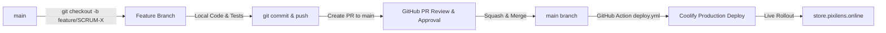

# Clean Architecture Solution Template

[](https://github.com/jasontaylordev/CleanArchitecture/actions/workflows/build.yml)
[](https://github.com/jasontaylordev/CleanArchitecture/actions/workflows/codeql.yml)
[](https://www.nuget.org/packages/Clean.Architecture.Solution.Template)
[](https://www.nuget.org/packages/Clean.Architecture.Solution.Template)


The goal of this template is to provide a straightforward and efficient approach to enterprise application development, leveraging the power of Clean Architecture and ASP.NET Core. Using this template, you can effortlessly create a new app with Angular, React, or Web API only, powered by ASP.NET Core and Aspire. Getting started is easy - simply install the **.NET template** (see below for full details).

For full documentation, visit **[cleanarchitecture.jasontaylor.dev](https://cleanarchitecture.jasontaylor.dev)**.

If you find this project useful, please give it a star. Thanks! ⭐

## Getting started

### Prerequisites

- [.NET 10.0 SDK](https://dotnet.microsoft.com/download/dotnet/10.0) or later
- [Node.js](https://nodejs.org/) (LTS) — only required if you plan to use the Angular or React frontend
- [Docker Desktop](https://www.docker.com/products/docker-desktop/) or [Podman](https://podman.io/) (or any OCI-compliant container runtime) — only required when using SQL Server or PostgreSQL. Not required when using SQLite (the default).

### Install the template

```bash
dotnet new install Clean.Architecture.Solution.Template
```

### Create a new solution

Create a new solution using the template. Specify the client framework using `--client-framework` (`-cf`) and the database provider using `--database` (`-db`):

```bash
dotnet new ca-sln --client-framework [angular|react|none] --database [postgresql|sqlite|sqlserver] --output YourProjectName
```

| Option | Values | Default |
|---|---|---|
| `--client-framework` | `angular`, `react`, `none` | `angular` |
| `--database` | `postgresql`, `sqlite`, `sqlserver` | `sqlite` |

**Examples:**

🅰️ Angular SPA with ASP.NET Core Web API and PostgreSQL:
```bash
dotnet new ca-sln -cf angular -db postgresql -o YourProjectName
```

⚛️ React SPA with ASP.NET Core Web API and SQL Server:
```bash
dotnet new ca-sln -cf react -db sqlserver -o YourProjectName
```

🔌 ASP.NET Core Web API only with SQLite:
```bash
dotnet new ca-sln -cf none -db sqlite -o YourProjectName
```

> 💡 **Tip:** Run `dotnet new ca-sln --help` to see all available template options.

### Run the app

Using the [Aspire CLI](https://aspire.dev/get-started/install-cli/) (recommended):

```bash
aspire run
```

Or using the .NET CLI:

```bash
dotnet run --project .\src\AppHost
```

The Aspire dashboard will open automatically, showing the application URLs and logs.

To learn more, see the [Getting started](https://cleanarchitecture.jasontaylor.dev/docs/getting-started/) guide and [Architecture](https://cleanarchitecture.jasontaylor.dev/docs/architecture/) overview.

## Technologies

* [ASP.NET Core 10](https://docs.microsoft.com/en-us/aspnet/core/introduction-to-aspnet-core)
* [Aspire](https://aspire.dev)
* [Entity Framework Core 10](https://docs.microsoft.com/en-us/ef/core/)
* [Angular 21](https://angular.dev/) or [React 19](https://react.dev/)
* [MediatR](https://github.com/jbogard/MediatR)
* [AutoMapper](https://automapper.org/)
* [FluentValidation](https://fluentvalidation.net/)
* [NUnit](https://nunit.org/), [Shouldly](https://docs.shouldly.org/), [Moq](https://github.com/devlooped/moq) & [Respawn](https://github.com/jbogard/Respawn)
* [Scalar](https://scalar.com/)

## Versions

The `main` branch is on **.NET 10.0**. Previous versions are available:

| Version | Branch |
|---|---|
| .NET 9.0 | [`net9.0`](https://github.com/jasontaylordev/CleanArchitecture/tree/net9.0) |
| .NET 8.0 | [`net8.0`](https://github.com/jasontaylordev/CleanArchitecture/tree/net8.0) |
| .NET 7.0 | [`net7.0`](https://github.com/jasontaylordev/CleanArchitecture/tree/net7.0) |
| .NET 6.0 | [`net6.0`](https://github.com/jasontaylordev/CleanArchitecture/tree/net6.0) |
| .NET 5.0 | [`net5.0`](https://github.com/jasontaylordev/CleanArchitecture/tree/net5.0) |
| .NET Core 3.1 | [`netcore3.1`](https://github.com/jasontaylordev/CleanArchitecture/tree/netcore3.1) |

## Architectural decisions

Key design decisions are documented as [Architecture Decision Records](docs/decisions/).

## Learn more

- 📖 [Clean Architecture Solution Template documentation](https://cleanarchitecture.jasontaylor.dev)

## Developer Workflow (Branching, PRs & Deployment)

This repository follows enterprise GitOps with automated testing and Coolify deployment on host `priyanka`.



### 1. Create a Feature Branch
Do not commit directly to `main`. For every Jira ticket (`SCRUM-6`, `SCRUM-7`, `SCRUM-10`, etc.), branch off the latest `main`:

```bash
git checkout main
git pull origin main
git checkout -b feature/SCRUM-6-inventory-tracking
```

### 2. Local Development & Testing
Run tests locally to validate Clean Architecture boundaries, FluentValidation rules, and MediatR handlers:

```bash
# Build solution
dotnet build

# Run unit tests
dotnet test --configuration Release
```

### 3. Commit and Push
```bash
git add .
git commit -m "feat(inventory): implement Product stock deduction command and validator (SCRUM-6)"
git push -u origin feature/SCRUM-6-inventory-tracking
```

### 4. Create Pull Request & Await Approval
1. Go to [GitHub Pull Requests](https://github.com/Kaushik-Sarkar-LPLA/clean-architecture-store/pulls).
2. Open a Pull Request from `feature/SCRUM-6-inventory-tracking` into `main`.
3. Provide a clear PR description referencing the Jira ticket ID.
4. Have the PR reviewed and approved.

### 5. Deploy to Production
Once approved and merged into `main`, deployment is triggered automatically or on-demand:
- **Automated**: Any push/merge to `main` automatically runs `.github/workflows/deploy.yml` which validates tests and invokes Coolify to rebuild and restart the Docker container on server `priyanka`.
- **Manual Trigger (GitHub Actions)**:
  1. Open [Actions -> Deploy to Production (Coolify)](https://github.com/Kaushik-Sarkar-LPLA/clean-architecture-store/actions/workflows/deploy.yml).
  2. Click **Run workflow** -> Select `Branch: main` -> Click **Run workflow**.
- **Live Endpoint**: [https://store.pixilens.online](https://store.pixilens.online) (Swagger / Scalar UI: `/scalar/v1`)

## Support

If you are having problems, please let me know by [raising a new issue](https://github.com/jasontaylordev/CleanArchitecture/issues/new/choose).

## License

This project is licensed under the [MIT License](LICENSE).
