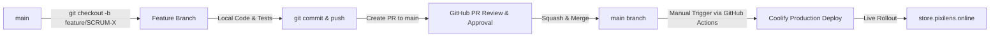

# Clean Architecture Store

.NET 10 Clean Architecture Web API with an Angular client and a **PostgreSQL** database. It is generated from [jasontaylordev/CleanArchitecture](https://github.com/jasontaylordev/CleanArchitecture) with `-cf Angular -db postgresql`.

- Production: https://store.pixilens.online (API docs: `/scalar/v1`)
- Jira: SCRUM board (Epic `SCRUM-5`)

## Database & migrations

- The database is **PostgreSQL only**.
- The schema is managed with **EF Core migrations** in `src/Infrastructure/Data/Migrations`.
- On startup the app applies any pending migrations (`Database.MigrateAsync()`) in every environment. Demo seed data is added in Development only.

When you change an entity or its configuration, add a migration in the same PR:

```bash
dotnet tool install -g dotnet-ef   # once
dotnet ef migrations add <Name> -p src/Infrastructure -s src/Web -o Data/Migrations
```

Never hand-edit existing migrations, and never delete `ApplicationDbContextModelSnapshot.cs`.

## Developer Workflow (Branching, PRs & Deployment)

This repository follows enterprise GitOps with automated testing and Coolify deployment on host `priyanka`.



### 1. Create a Feature Branch
Do not commit directly to `main`. For every Jira ticket (`SCRUM-6`, `SCRUM-7`, `SCRUM-10`, etc.), branch off the latest `main`:

```bash
git checkout main
git pull origin main
git checkout -b feature/SCRUM-6-inventory-tracking
```

### 2. Local Development & Testing
Run tests locally to validate Clean Architecture boundaries, FluentValidation rules, and MediatR handlers:

```bash
# Build solution
dotnet build

# Run unit tests
dotnet test --configuration Release
```

### 3. Commit and Push
```bash
git add .
git commit -m "feat(inventory): implement Product stock deduction command and validator (SCRUM-6)"
git push -u origin feature/SCRUM-6-inventory-tracking
```

### 4. Create Pull Request & Await Approval
1. Go to [GitHub Pull Requests](https://github.com/Kaushik-Sarkar-LPLA/clean-architecture-store/pulls).
2. Open a Pull Request from `feature/SCRUM-6-inventory-tracking` into `main`.
3. Provide a clear PR description referencing the Jira ticket ID.
4. Have the PR reviewed and approved by the team lead.
5. Squash & Merge the PR into `main`.

### 5. Manual Production Deployment (No Auto-Deploys)
**Important:** Merging to `main` does **not** automatically deploy. The developer must manually trigger the deployment workflow in GitHub Actions when ready:
1. Navigate to [Actions -> Deploy to Production (Coolify)](https://github.com/Kaushik-Sarkar-LPLA/clean-architecture-store/actions/workflows/deploy.yml).
2. Click the **Run workflow** dropdown on the right.
3. Keep `Branch: main` selected.
4. (Optional) Enter a deployment reason / release note.
5. Click **Run workflow**.
6. The workflow will run the full test suite, trigger Coolify container rebuild on server `priyanka`, and verify that [https://store.pixilens.online/scalar/v1](https://store.pixilens.online/scalar/v1) returns HTTP 200 OK.

